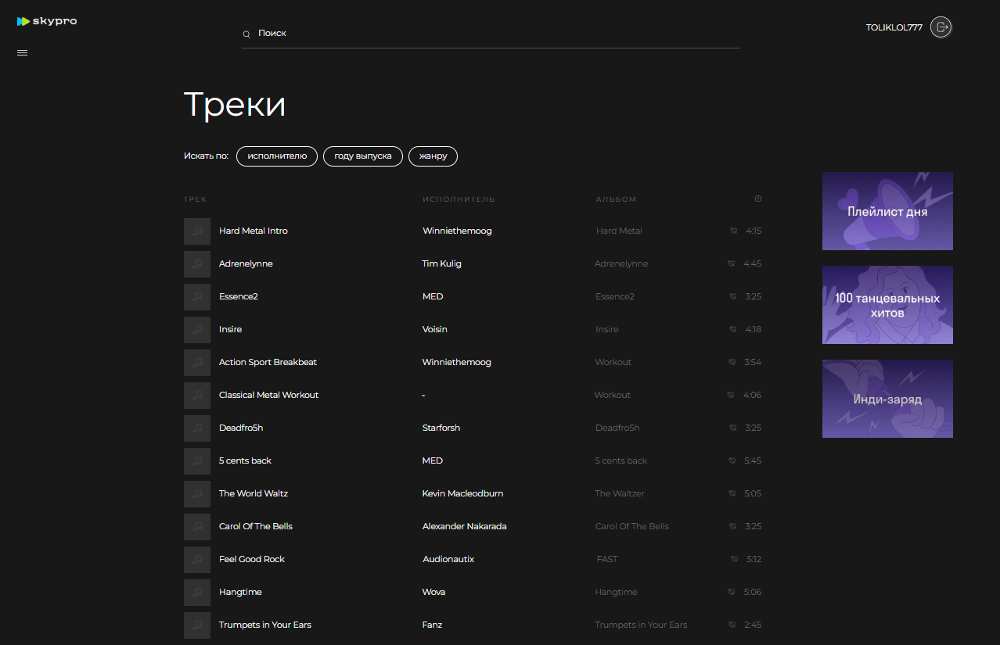

# skypro-music

Веб-приложение для прослушивания музыки. Учебный проект курса SkyPro, который я развиваю самостоятельно.

> Статус: в разработке.



## Что внутри

- Список треков загружаюшихся с API
- Плеер: пауза, перемотка, громкость, перемешивание и зацикливание треков
- Авторизация и избранное
- Сохрание и вход по ACCESS и REFRESH токенами
- Приватный роутинг в разделе избранное

## Стек

- [Next.js](https://nextjs.org) (App Router)
- TypeScript
- ESLint и Prettier для единого стиля кода

## Запуск локально

Нужна актуальная LTS-версия Node.js.

```bash
git clone https://github.com/TOLIKLOL777/skypro-music.git
cd skypro-music
npm install
npm run dev
```

Откройте [http://localhost:3000](http://localhost:3000) в браузере.

### Команды

| Команда         | Что делает                     |
| --------------- | ------------------------------ |
| `npm run dev`   | запускает dev-сервер           |
| `npm run build` | собирает проект для продакшена |
| `npm run start` | запускает собранную версию     |
| `npm run lint`  | проверяет код ESLint           |

## Структура

```
public/     статические файлы
src/app/    страницы и компоненты (Next.js App Router)
```

## Планы

- [ ] Доработка кнопок для действий
- [ ] Адаптивная вёрстка под мобильные устройства
- [ ] Деплой на Vercel
- [ ] Поиск и фильтр треков

## Автор

Анатолий Константинов, frontend-разработчик.
[GitHub](https://github.com/TOLIKLOL777) · Telegram: [@TOLIKLOL777](https://t.me/TOLIKLOL777)
